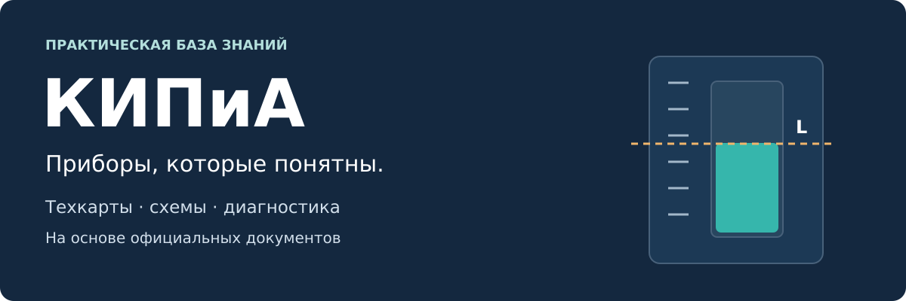

<p align="center"></p>

# КИПиА

> **Проверка содержания:** [отчёт об аудите, найденных ошибках и оставшихся ограничениях](QUALITY_AUDIT.md).
>
> **Подготовка к III группе:** [программа](docs/22-third-group.md) · [виды работ](docs/23-types-of-work.md) · [персонал и ответственность](docs/24-personnel-and-roles.md) · [51 вопрос](docs/28-third-group-questions.md).
>
> **Новый раздел:** [Электробезопасность для слесаря КИПиА — учебник, словарь, 25 вопросов, первая помощь](docs/index.md). [Сайт справочника (после включения GitHub Pages)](https://maximvalishevskiynz.github.io/KIPiA/).


Понятные руководства по контрольно-измерительным приборам и автоматике: от принципа работы до проверки сигнала на входе ПЛК. Технические данные — из документов производителя, объяснения и схемы — своими словами.

**Начать здесь → [Техкарта Prosonic с поплавком на каскаде флотации ТОФ](Тех%20карты/Уровень/Endress+Hauser/Prosonic/00-техкарта-флотация.md)**

| Нужно сейчас | Открыть |
| --- | --- |
| Разобраться, что измеряет Prosonic | [Принцип работы и монтаж](Тех%20карты/Уровень/Endress+Hauser/Prosonic/01-принцип-и-монтаж.md) |
| Подключить и настроить прибор | [FMU30](Тех%20карты/Уровень/Endress+Hauser/Prosonic/02-fmu30.md) · [FMU40–44 HART](Тех%20карты/Уровень/Endress+Hauser/Prosonic/03-prosonic-m-hart.md) · [FMU90 HART](Тех%20карты/Уровень/Endress+Hauser/Prosonic/04-fmu90-hart.md) |
| Найти причину неправильного показания | [Диагностика по симптомам](Тех%20карты/Уровень/Endress+Hauser/Prosonic/05-диагностика.md) |
| Проверить расчёт и сдать работу | [Примеры и приёмка](Тех%20карты/Уровень/Endress+Hauser/Prosonic/06-примеры-и-приёмка.md) |
| Взять техкарту на участок | [Техкарта в PDF · 6 страниц](Материалы/Prosonic-техкарта-флотация.pdf) |
| Читать полное руководство без интернета | [Полное руководство в PDF](Материалы/Prosonic-понятное-руководство.pdf) |
| Найти подтверждение в оригинале | [Официальные источники и страницы](Тех%20карты/Уровень/Endress+Hauser/Prosonic/источники.md) |

## Как устроена база

```text
Тех карты/        тип измерения → производитель → семейство
Шаблоны/          карточка прибора, пусконаладка, диагностика, источники
Оформление/       дизайн-код, цвета, правила схем, SVG-шаблон
Материалы/        версии для печати
.github/          шаблоны задач, изменений и автоматическая проверка ссылок
scripts/          проверка документации и сборка PDF
```

Папка называется **«Тех карты»** по назначению: короткие рабочие карты и справочные инструкции для приборов. Адрес репозитория — `KIPiA`, поскольку GitHub не поддерживает кириллицу в имени репозитория; название базы — **КИПиА**.

## Что считается готовым материалом

У каждого руководства указаны модель и исполнение, есть схема с границами применимости, понятная последовательность действий, ожидаемый результат и ссылки на конкретные разделы официальных документов. Учебные числа помечены как примеры. Сведения с реального объекта фиксируются отдельно в протоколе.

**Основной материал — общая техкарта Prosonic с поплавком для каскада флотации ТОФ.** Точная модель и механика узла пока неизвестны. Подключение и меню вынесены в раздельные справочные разделы: перед их использованием нужно сверить шильдик, интерфейс, питание и версию ПО.

## Единый стиль

Используй [дизайн-код](Оформление/ДИЗАЙН-КОД.md) и [шаблоны](Шаблоны/README.md), чтобы следующие приборы выглядели так же. Правила внесения изменений — в [CONTRIBUTING.md](CONTRIBUTING.md).

Версия материалов: **1.0 · 15 октября 2026**. Это независимое практическое руководство, не официальный документ Endress+Hauser. Исходные руководства принадлежат производителю; в базе хранятся ссылки на них, а не копии PDF.
