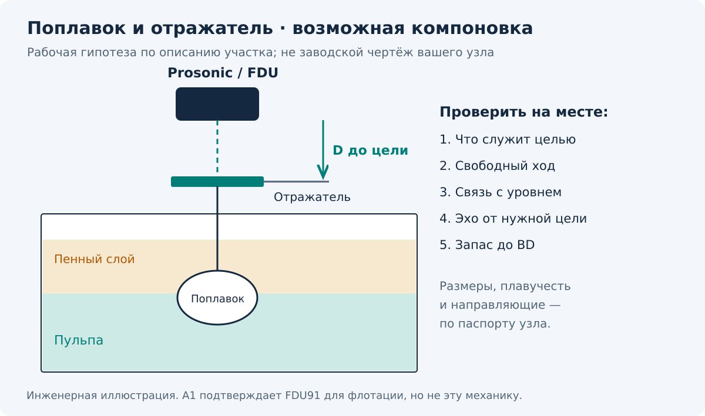
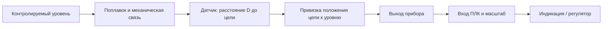

[КИПиА](../../../../README.md) · [Полное руководство Prosonic](README.md)

# Техкарта · Prosonic с поплавком на каскаде флотации ТОФ

**Задача:** проверить измерение уровня и передачу сигнала в систему управления. Карта подходит для обследования точки с неизвестной моделью Prosonic. Конкретные клеммы и настройки выбирают после чтения шильдика.

| Поле | Что известно / что заполнить на объекте |
| --- | --- |
| Участок | Каскад флотации, ТОФ — по описанию пользователя |
| Позиция по схеме, номер каскада | Не указаны |
| Модель FMU и, если есть, датчик FDU | Не установлены |
| Назначение | Контроль уровня; участие в регулировании и защитах уточнить |
| Механический элемент | По описанию пользователя — поплавок; конструкция не установлена |
| Акустическая цель | Уточнить: сам поплавок, отражатель на штоке или другая конструкция |
| Диапазон, единицы, сигнал, питание | Считать из проекта, шильдика и действующей конфигурации |
| Основание карты | Официальные руководства Endress+Hauser: T1, M1, S1 |
| Статус | Общая рабочая карта; параметры конкретной точки не подтверждены |

## 1. Разобраться в цепочке «уровень → поплавок → эхо»

Prosonic — ультразвуковой прибор: он измеряет расстояние до отражающей цели. В описанной пользователем установке есть поплавок. Возможная компоновка: поплавок следует за уровнем, а датчик смотрит на него или на отражатель, связанный с ним. Это **рабочая гипотеза о конструкции**, которую нужно проверить на месте, а не установленная модель узла.

**Проверяй три звена:** поплавок правильно следует за контролируемым уровнем → отражатель движется предсказуемо → Prosonic видит именно отражатель. Исправный токовый выход не исключает заедание поплавка; устойчивое эхо не доказывает правильную плавучесть.

В официальном отраслевом документе Endress+Hauser для флотации показан **Prosonic S FDU91 с отдельным преобразователем FMU90/FMU95**. Это делает такой вариант возможным, но не идентифицирует ваш прибор. Конструкция поплавкового узла в найденных руководствах не описана; для неё нужны паспорт узла и схема объекта. [A1, с.14–15]

На рисунке — условная компоновка, не чертёж установленного оборудования. Пена и пульпа показаны для объяснения задачи; положение поплавка на их границе не задано.

На схеме — принцип прохождения информации. Фактический интерфейс и участие регулятора пока неизвестны.

## 2. Подготовить проверку

1. Найди позицию прибора и связанный канал ПЛК; запиши текущий уровень, выходной сигнал, код ошибки и время.
2. Уточни по проекту, какой уровень должен отслеживать поплавок и как его безопасно подтвердить независимо. Найди паспорт поплавкового узла, его отражатель и направляющие, если они есть.
3. Зафиксируй состояние процесса: подача пульпы, аэрация, выраженность пены, работа мешалок, идёт ли заполнение/опорожнение. Это поля протокола обследования, а не готовые настройки.
4. Сохрани действующие E/F, единицы, линеаризацию, карту помех, демпфирование и аварийную реакцию. Для FMU90 запиши также назначение датчика и канала. Запиши, на какую цель направлен датчик.
5. Если изменение выхода влияет на регулирование или защиту, проверку с симуляцией, отключением или изменением настроек выполняют в согласованном режиме объекта. Сначала допускаются наблюдение и чтение параметров.

Не открывай крышку и не отсоединяй провода до определения питания и исполнения. Обесточивание перед подключением требуется в официальных руководствах. [T1, с.16; M1, §4.1; S1, §6.3.1]

## 3. Осмотреть точку измерения

| Проверить | Что зафиксировать | Почему это влияет |
| --- | --- | --- |
| Поплавок | Целостность, налипание, изменение массы, свободный ход | Положение может перестать соответствовать уровню |
| Шток / направляющая, если есть | Заедание, перекос, трение, люфт, упоры | Передача движения может искажаться |
| Отражающая цель | Целостность, наклон, загрязнение, положение относительно луча | Датчик может терять цель или видеть другую деталь |
| Мембрана датчика | Налипание, загрязнение, повреждения | Полезное эхо может ослабевать |
| Зона между датчиком и целью | Брызги, струя, детали конструкции | Возможно ложное или нестабильное отражение |
| Ориентация | Попадает ли луч в цель при всём ходе | Точное требование к отражателю берут из паспорта узла |
| Монтажный патрубок | Диаметр, длина, заусенцы | Сам патрубок способен давать помехи |
| Верхнее положение цели | Минимальное расстояние до мембраны, запас до BD | Отражатель не должен входить в ближнюю зону |
| Кабель и корпус | Влага, вводы, трасса рядом с силовыми кабелями | Возможны электрические помехи и потеря связи |

Проверки ультразвуковой части основаны на [T1, §3.3–3.4, §7.2; M1, §3.3–3.4, §7.2; S1, с.28,78]. Проверки поплавка и механической связи — инженерные рекомендации для обследования по описанию пользователя; размеры, масса и допустимый ход берутся из паспорта узла. Очистку выполняют способом, совместимым с материалами и средой. [T1, §8.1; M1, §8.1]

## 4. Разделить причину на три участка

| Наблюдение | Следующий шаг |
| --- | --- |
| Поплавок не следует за независимо подтверждённым уровнем | Проверить плавучесть и механику по паспорту узла; электронная поправка причину не устраняет |
| Поплавок и цель движутся правильно, D неверное | Проверить, какое эхо выбрано, положение цели, монтаж и огибающую |
| D до цели верное, локальный L неверный | Проверить привязку цели к уровню, E/F, выбранный ноль, единицы и линеаризацию |
| Локальный L верный, значение ПЛК неверное | Проверить фактический сигнал, назначение выхода, вход ПЛК и его масштаб |

Логика разделения основана на [T1, с.32–33,38; M1, с.46–47,53; S1, с.78]. Проверка ПЛК — инженерная процедура этой карты, а не меню производителя.

**При скачках на аэрации или изменении пенного слоя** запиши одновременно положение поплавка/цели, D, L, огибающую эха и состояние процесса. Различай реальное колебание поплавка и перескок датчика на другое отражение. Не увеличивай демпфирование без проверки допустимого времени реакции контура.

### Как привязать отражатель к уровню

Если отражатель жёстко связан с поплавком и движется вертикально **1:1**, постоянное смещение между ним и уровнем учитывают при привязке нуля. Пусть `D0` — расстояние до цели при подтверждённом нулевом уровне. Тогда изменение уровня `L = D0 − D`. В такой частной схеме E соответствует D0, а не расстоянию до дна камеры.

Это расчётная модель, а не готовая настройка вашего узла. При рычагах, ином передаточном отношении или изменении осадки поплавка зависимость проверяют по паспорту и нескольким опорным положениям; простую формулу автоматически не применяют. Пример расчёта: [раздел 06](06-примеры-и-приёмка.md).

## 5. Если требуется перенастройка

1. Определи модель: [FMU30](02-fmu30.md), [FMU40–44 HART](03-prosonic-m-hart.md) или [FMU90 HART](04-fmu90-hart.md).
2. Подтверди привязку цели к уровню, E, F, BD и реальные единицы. Шаги точной модели выполняй только после проверки исполнения.
3. Выбери условия процесса по фактической поверхности. Случайные «универсальные» значения задержки, фильтра и усиления для флотации здесь не задаются.
4. Перед картой помех независимо установи D **до рабочей отражающей цели**. Отступы 0,3 м у FMU30 и 0,5 м у Prosonic M взяты из их инструкций для измерения поверхности продукта; применение к поплавковому узлу нужно подтвердить по его документации. У FMU90 следуй его мастеру и инструкции FDU. Не записывай полезное эхо цели в карту и не включай автоматически весь ход поплавка в область подавления.
5. Проверь аварийную реакцию и задержку с учётом требований объекта, затем согласованно проверь передачу сигнала.

Источники: [T1, с.28–33; M1, с.41–47; S1, с.49–56].

## 6. Критерии завершения

- Установлены модель, питание, интерфейс, позиция и назначение канала.
- Проверены свободный ход поплавка, связь с отражателем и привязка его положения к уровню.
- Установлено, от какой цели приходит эхо, и она остаётся видимой при рабочем ходе.
- D и L согласуются с независимой проверкой в доступных рабочих состояниях.
- Передача сигнала и шкала ПЛК проверены; результат записан численно.
- Реакция на потерю эха/аварию соответствует принятой логике объекта.
- Симуляция выключена, рабочий режим восстановлен, изменения сохранены в протоколе.

Если подтверждены только отдельные пункты, в протоколе укажи границы проверки. Проверка входа ПЛК имитатором не подтверждает, что прибор правильно видит поверхность в камере.

**Бланк:** [Пусконаладка](../../../../Шаблоны/Пусконаладка.md). **Поиск неисправности:** [Диагностика](05-диагностика.md). **Оригиналы:** [Реестр источников](источники.md).
