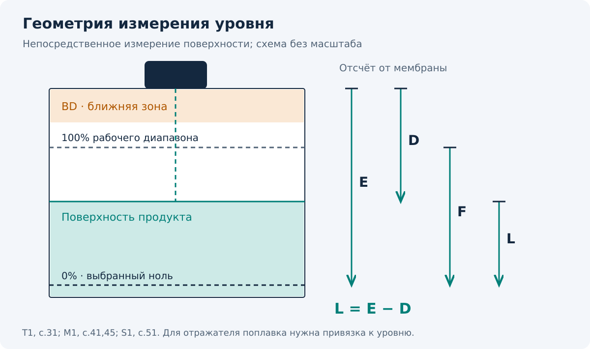

[К оглавлению](README.md) · Далее: [FMU30](02-fmu30.md)

# 01 · Как работает Prosonic и где его поставить

> Для установки с поплавком сначала читай [техкарту флотации](00-техкарта-флотация.md): датчик может видеть поплавок или отражатель, а не сам продукт. Ниже объясняется штатная геометрия непосредственного измерения поверхности по руководствам производителя.

## Что прибор измеряет на самом деле

Датчик посылает ультразвуковой импульс, принимает отражение от поверхности и измеряет время пути туда и обратно. По этому времени он получает **расстояние D от рабочей поверхности датчика до продукта**. Уровень L вычисляется из введённого расстояния до нулевой отметки E:

```text
D = c × t / 2
L = E − D
```

`c` — скорость звука в среде над продуктом, `t` — время двойного пути. Встроенный температурный датчик помогает корректировать изменение скорости звука с температурой. Это не превращает любой газовый состав или сильную пену в подходящие условия измерения. [T1, §11.2; M1, §11.2]



| Обозначение | По-человечески | Что важно |
| --- | --- | --- |
| **E — Empty calibration** | От мембраны до выбранного нуля уровня | Это не автоматически высота бака |
| **F — Full calibration** | Высота рабочего диапазона от 0 до 100% | Это не расстояние от датчика до полного бака |
| **D — Distance** | Сколько воздуха между датчиком и поверхностью | С этого значения начинай диагностику |
| **L — Level** | Насколько поверхность выше выбранного нуля | При правильном E: `L = E − D` |
| **BD — Blocking distance** | Ближняя зона, где прибор не должен измерять | Верхний уровень должен оставаться ниже этой зоны |
| **SD — Safety distance** | Настраиваемая зона предупреждения перед BD | Она не уменьшает физическую BD |

Верхний рабочий уровень должен удовлетворять условию `E − F ≥ BD`. На объекте оставляют дополнительный запас с учётом волн, перелива и принятого SD. [T1, с.14,31; M1, с.24,45; S1, с.51]

## Почему E и F часто путают

**Учебный пример:** от мембраны до нулевой отметки 5,00 м; рабочий уровень от 0 до 4,00 м. Значит, `E = 5,00 м`, `F = 4,00 м`. При полном рабочем диапазоне до продукта остаётся `1,00 м`. Когда измеренное `D = 2,00 м`, уровень `L = 3,00 м`, то есть 75% диапазона.

Ноль можно выбрать выше физического дна. При коническом или выпуклом днище нельзя размещать его ниже точки, где ультразвуковой луч впервые попадает в днище. [T1, с.31; M1, с.45; S1, с.51]

## Куда направить датчик

Для жидкости мембрану располагают параллельно поверхности. Луч должен видеть продукт, а не струю заполнения, лестницу, трубу, мешалку или стенку. Для сыпучего продукта учитывают наклон поверхности и рекомендации по ориентации датчика.

Для компактных FMU30 и FMU40–44 производитель рекомендует отступ от стенки около **1/6 диаметра бака** и не рекомендует монтаж в центре. Это начальная рекомендация; фактическое место выбирают по геометрии ёмкости и эхо-сигналу. [T1, с.11; M1, §3.3.1]

- Не ставь датчик над падающей струёй.
- Убери препятствия из акустического луча.
- Проверь допустимые диаметр и длину патрубка по таблице своей модели. Внутри нужны гладкие стенки без заусенцев и выступающих сварных швов.
- Защити корпус от прямого солнца и осадков подходящим козырьком.
- Для FMU30 и Prosonic M не устанавливай второй независимый ультразвуковой прибор в ту же ёмкость без решения вопроса взаимного влияния. Для систем Prosonic S предусмотрена синхронизация; её выполняют по отдельной схеме производителя.

Источник: [T1, §3.3–3.4; M1, §3.3–3.4; S1, §6.3.6].

## От чего измерение становится нестабильным

Пена, пыль, турбулентность, сильный шум заполнения и препятствия могут ослабить полезное эхо или создать ложное. Увеличение демпфирования сглаживает показание, но замедляет реакцию. Оно не устраняет неправильное место установки. Сначала сравни реальное расстояние D с тем, что видит прибор; затем выбирай параметры среды и процесса. [T1, с.29–30,38; M1, §6.3.1, §7.2; S1, с.78]

Максимальная дальность из таблицы — предел для соответствующей модели и среды. При неблагоприятных условиях пригодный диапазон может быть меньше. Подбор по акустическим условиям см. [T3, раздел «Measuring range»; M3, раздел «Measuring range»].

**Источники раздела:** [T1, T3, M1, M3, S1](источники.md). Все числовые примеры здесь учебные.
