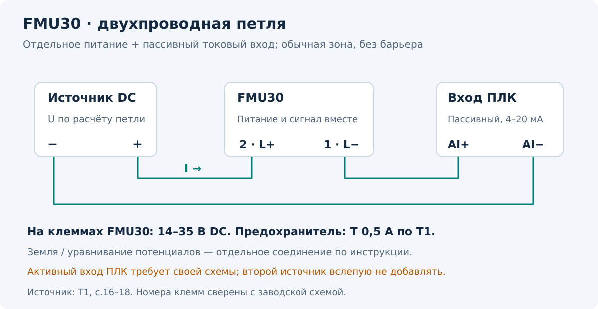

[К оглавлению](README.md) · [Общий принцип](01-принцип-и-монтаж.md)

# 02 · Prosonic T FMU30

**Применимость:** FMU30, двухпроводное питание по петле 4–20 мА, по BA00387F/00/EN/14.14. В этом руководстве FMU30 не рассматривается как HART-прибор. Для связи с ПК производитель описывает сервисное подключение через FXA291 и ToF Adapter; обычный HART-модем не является его заменой. [T1, §5.3; T3, «Output»]

## Основные пределы

| Датчик | BD | Максимум для жидкости | Максимум для сыпучего |
| --- | --- | --- | --- |
| 1½″ | 0,25 м | 5 м | 2 м |
| 2″ | 0,35 м | 8 м | 3,5 м |

Это верхние пределы из [T1, с.14]; фактическая дальность зависит от условий. Не путай размер резьбы с высотой рабочего диапазона.

## Подключение

**Схема применима к обычной петле с отдельным источником питания и пассивным токовым входом.** Если вход ПЛК уже питает датчик, нужен его паспорт: второй источник питания в такую петлю автоматически не добавляют.

| Клемма FMU30 | Назначение |
| --- | --- |
| **1 — L−** | Минус петли |
| **2 — L+** | Плюс петли |
| **3 / знак земли** | Заземление; не сигнальный минус |

По [T1, с.16–18] напряжение **непосредственно на клеммах прибора — 14–35 В DC**. На официальной схеме указан предохранитель **T 0,5 А по IEC 60127**. Подключение выполняют при снятом питании; уравнивание потенциалов соединяют до подключения сигнальной цепи. Экран и заземление выполняют по инструкции и проекту; для Ex действуют дополнительные XA.

**Учебный расчёт:** при источнике 24 В и сопротивлении входа 250 Ом на входе при 20 мА падает 5 В. Без учёта проводов на датчике останется 19 В. Остаток проверяют с учётом кабеля, барьера и остальных последовательных элементов. [Расчёт петли](06-примеры-и-приёмка.md)

## Перед настройкой

1. Запиши модель, код заказа, фактическое питание и текущие настройки в [протокол](../../../../Шаблоны/Пусконаладка.md).
2. Определи нулевую и максимальную рабочие отметки. Измерь E и вычисли F.
3. Проверь `E − F ≥ BD` и выбранный запас до ближней зоны.
4. Найди достоверное расстояние до поверхности для сравнения с D. Все действия с измерением на ёмкости выполняют по правилам объекта.
5. Согласуй проверку выходного сигнала и режим управления, если петля участвует в автоматике.

## Базовая настройка с дисплея

Открой группу **`basic setup (00)`**. Названия оставлены на английском, чтобы их можно было найти на приборе. [T1, с.28–33]

| Шаг | Пункт меню | Что вводить или проверять |
| --- | --- | --- |
| 1 | `tank shape (002)` | Реальную форму ёмкости; открытая ёмкость — соответствующий вариант `no ceiling` |
| 2 | `medium property (003)` | Жидкость, сыпучий продукт или `unknown` по свойствам среды |
| 3 | `process cond. (004)` | Условия поверхности и скорость изменения уровня; это влияет на фильтры |
| 4 | `empty calibr. (005)` | E — от мембраны до нулевой отметки |
| 5 | `full calibr. (006)` | F — высоту от 0 до 100% рабочего диапазона |
| 6 | `dist./meas.value (008)` | D и L: сравнить с фактическими значениями |
| 7 | `check distance (051)` | Указать, совпадает ли D с действительностью |
| 8 | `range of mapping (052)` | Проверить границу карты помех |
| 9 | `start mapping (053)` | Запустить запись карты, если предыдущие проверки позволяют это сделать |
| 10 | `dist./meas.value (008)` | Повторно проверить D и L после записи |

После базовой настройки проверь `safety distance (015)`, реакцию `in safety dist. (016)` и поведение выхода при потере эха/аварии по требованиям объекта. Эти реакции не выбирают наугад. [T1, с.31; T2, группа `safety settings (01)`]

## Карта помех: граница важнее кнопки запуска

Карта помех помогает прибору отличать отражение от конструкции бака от отражения от продукта. Записывать в неё полезное эхо поверхности нельзя.

> [!WARNING]
> **Для FMU30 граница карты должна закончиться за 0,3 м до фактического эха поверхности.** Для пустой ёмкости производитель указывает `E − 0,3 м`, а не E. Источник: [T1, с.32]. Это значение отличается от Prosonic M.

**Учебный пример:** при реальном D = 2,00 м ручная граница карты — не дальше 1,70 м. При пустой ёмкости с E = 5,00 м — не дальше 4,70 м. Если фактическое расстояние неизвестно, выбирают `dist. unknown` и не выполняют запись вслепую.

Если прибор показывает D **больше реального**, инструкция предлагает проверить параметры среды, процесса и E; карта помех не исправляет этот случай. Если D **меньше реального**, возможен захват отражения от препятствия. [T1, с.32]

## Когда пуск можно считать проверенным

- D соответствует независимо установленному расстоянию.
- L соответствует выбранным E и нулевой отметке.
- ПЛК верно преобразует ток в уровень, единицы и диапазоны совпадают.
- После изменения уровня показание меняется ожидаемо; симуляция выключена.
- Поведение при неисправности согласовано и задокументировано.

Проверки и расчётные точки: [примеры и приёмка](06-примеры-и-приёмка.md). Коды ошибок: [диагностика](05-диагностика.md).

**Источники:** [T1, T2, T3](источники.md).
