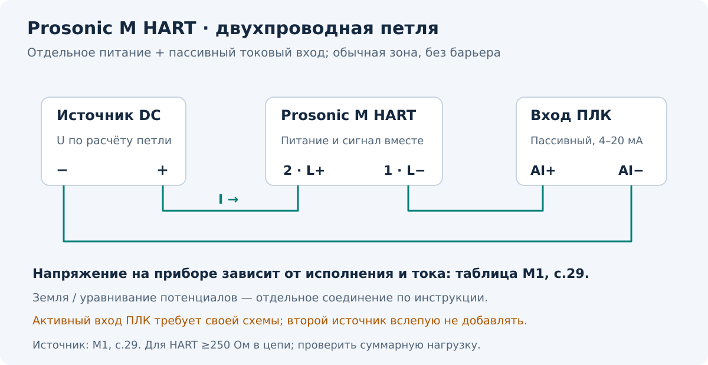
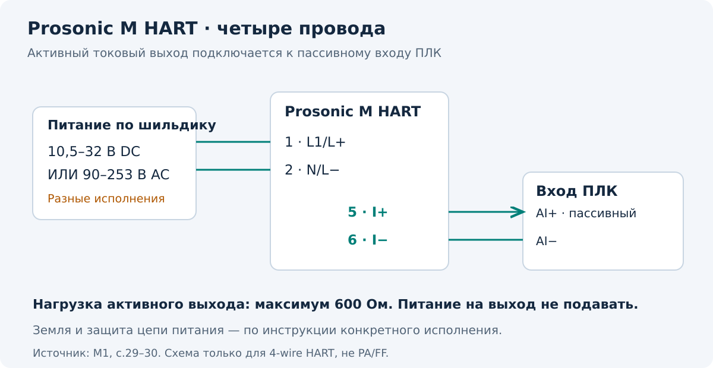

[К оглавлению](README.md) · [Общий принцип](01-принцип-и-монтаж.md)

# 03 · Prosonic M FMU40/41/42/43/44 — HART

**Применимость:** исполнения HART по BA00237F/00/EN/13.12, ПО усилителя и связи V01.04.00 и далее в пределах применимости документа. Для PROFIBUS PA используется BA00238F, для FOUNDATION Fieldbus — BA00239F. На эти исполнения схемы ниже не переносятся. [M1, титул; M3, «Output»]

## Чем отличаются модели

| Модель | BD | Жидкость, максимум | Сыпучий продукт, максимум |
| --- | --- | --- | --- |
| FMU40 | 0,25 м | 5 м | 2 м |
| FMU41 | 0,35 м | 8 м | 3,5 м |
| FMU42 | 0,40 м | 10 м | 5 м |
| FMU43 | 0,60 м | 15 м | 7 м |
| FMU44 | 0,50 м | 20 м | 10 м |

Источник: [M1, с.24]. Дальность зависит от затухания, поверхности и монтажа; это не гарантированный диапазон в любых условиях.

## Двухпроводное исполнение HART

| Клемма | Назначение |
| --- | --- |
| **1 — L−** | Минус петли |
| **2 — L+** | Плюс петли |
| Земля на корпусе | Уравнивание потенциалов по инструкции |

Клеммы и контрольные точки, показанные в оригинале для проверки тока, не используют как произвольную вторую токовую петлю. Источник схемы: [M1, с.29].

Допустимое напряжение на клеммах зависит от тока и исполнения:

| Исполнение 2-wire HART | Минимум при 4 мА | Минимум при 20 мА | Максимум |
| --- | --- | --- | --- |
| Standard | 14 В | 8 В | 36 В |
| Ex ia | 14 В | 8 В | 30 В |
| Ex d | 14 В | 11 В | 30 В |

Это таблица [M1, с.29] для указанного режима. Она не заменяет условия XA и согласование искробезопасной цепи. Режимы фиксированного тока и multidrop имеют отдельные условия; при multidrop ток не используют как обычное аналоговое представление уровня.

Для связи HART требуется коммуникационное сопротивление **не менее 250 Ом** с соблюдением допустимой нагрузки. Сначала выясни, какое сопротивление уже есть в цепи: вход ПЛК, барьер или источник питания могут его обеспечивать. Дополнительные 250 Ом всегда создают дополнительное падение напряжения. [M1, с.29; M3, «Load»]

## Четырёхпроводное исполнение HART

Здесь питание прибора и выходной сигнал разведены. На выходе — **активный** сигнал. [M1, с.29–30]

| Клемма | Назначение |
| --- | --- |
| **1 — L1/L+** | Фаза или плюс питания по исполнению |
| **2 — N/L−** | Нейтраль или минус питания по исполнению |
| **5 — I+** | Плюс активного токового выхода |
| **6 — I−** | Минус активного токового выхода |

Есть отдельные варианты питания: **10,5–32 В DC** или **90–253 В AC, 50/60 Гц**. Это разные исполнения; тип питания проверяют на шильдике. Максимальная нагрузка активного выхода — **600 Ом**. [M1, с.30]

> [!WARNING]
> На активный токовый выход не подают питание от активного входа ПЛК. Для схемы выше нужен пассивный токовый вход. Цепи питания и сигнала проверяют отдельно по маркировке конкретного прибора.

## Настройка

Группа `basic setup (00)` проводит по основным параметрам. [M1, с.41–47]

| Пункт | Действие |
| --- | --- |
| `tank shape (002)` | Выбрать форму ёмкости |
| `medium property (003)` | Выбрать тип продукта |
| `process cond. (004)` | Выбрать реальные условия процесса |
| `empty calibr. (005)` | Ввести E от мембраны до нулевой отметки |
| `full calibr. (006)` | Ввести F — высоту рабочего диапазона |
| `dist./meas.value (008)` | Проверить D и L до записи карты |
| `check distance (051)` | Сравнить показанное и фактическое D |
| `range of mapping (052)` | Установить безопасную границу карты |
| `start mapping (053)` | Записать карту и снова проверить D/L |

> [!WARNING]
> **У Prosonic M граница карты должна быть за 0,5 м до реального эха поверхности.** Для пустой ёмкости — `E − 0,5 м`. Источник: [M1, с.46]. Значение 0,3 м из инструкции FMU30 здесь не применяют.

**Учебный пример:** реальное D = 2,00 м → граница карты не дальше 1,50 м. E = 5,00 м и пустая ёмкость → не дальше 4,50 м.

После пуска открой огибающую в группе `envelope curve (0E)`: полезное эхо должно соответствовать ожидаемому расстоянию. Проверь зону SD, аварийный ток, задержку и реакцию на потерю эха по требованиям объекта; проверь масштаб ПЛК и выключение симуляции. [M1, с.45,48–50; M2, группы `safety settings`, `output`]

Если D верное, а L неправильное, сначала проверь E и линеаризацию. Если локальное L верное, а на ПЛК неверное — переходи к проверке тока и масштаба. [Диагностика](05-диагностика.md)

**Источники:** [M1, M2, M3](источники.md).
