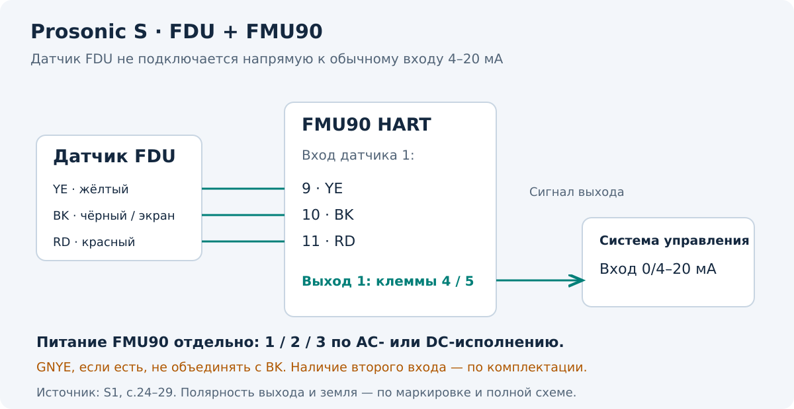

[К оглавлению](README.md) · [Общий принцип](01-принцип-и-монтаж.md)

# 04 · Prosonic S FMU90 HART — измерение уровня

**Применимость:** FMU90 HART, измерение уровня с одним или двумя датчиками, по BA00288F/00/EN/16.21 от 31.05.2021. Инструкции для расхода, управления насосами и решётками здесь не разобраны: для них нужны соответствующее исполнение и отдельная проверка логики.

## Здесь датчик и преобразователь раздельные

FDU находится над продуктом, FMU90 обрабатывает его сигнал. **Кабель FDU — не стандартная петля 4–20 мА.** Выход 0/4–20 мА формирует FMU90. Диапазон и BD определяются подключённой моделью датчика; универсального значения для всех FMU90 нет. [S1, с.24–29,50–51]



## Питание и основные клеммы

| Цепь | Клеммы | Назначение |
| --- | --- | --- |
| Питание AC-исполнения | **1 / 2 / 3** | L / N / уравнивание потенциалов; 90–253 В AC |
| Питание DC-исполнения | **1 / 2 / 3** | L+ / L− / уравнивание потенциалов; 10,5–32 В DC |
| Аналоговый выход 1 | **4 / 5** | 0/4–20 мА, HART; полярность — по маркировке клемм |
| Аналоговый выход 2, опция | **41 / 42** | 0/4–20 мА |
| Датчик 1 | **9 / 10 / 11** | YE / BK / RD: жёлтый / чёрный (экран) / красный |
| Датчик 2, опция | **12 / 13 / 14** | YE / BK / RD |
| Синхронизация | **39 / 40** | Связь нескольких преобразователей по схеме производителя |

Источник: [S1, с.24–25]. Клеммы серого цвета на схеме производителя присутствуют не во всех комплектациях. В двухканальном варианте расположение подключения первого датчика отличается от одноканального — ориентируйся на номера, а не только на место колодки.

Предохранитель по S1: AC-исполнение — **400 мА T**, DC-исполнение — **2 А T**. Тип питания выбирают по шильдику: указанные AC/DC диапазоны не означают, что любой экземпляр принимает оба. [S1, с.24]

## Что важно в кабеле FDU

- Чёрный провод BK — экран, он подключается к клемме BK.
- Если у датчика есть защитный провод GNYE, не объединяй его с экраном. Подключение уравнивания потенциалов выполняют по типу датчика и корпуса.
- Для металлических датчиков FDU91F/93/95 инструкция требует соединения GNYE с местным уравниванием потенциалов на расстоянии не более 30 м от датчика.
- Не прокладывай кабель датчика параллельно силовым линиям и возле частотных преобразователей.
- Провода BN/BU у датчиков с обогревом относятся к отдельной цепи обогрева, а не к входу YE/BK/RD. При обогреве производитель требует внешний датчик температуры для коррекции времени прохождения звука и его назначение этому каналу.

Источники: [S1, с.28–29,34–35]. Для удлинения кабеля, взрывозащиты и совместимости старых FDU8x нужна полная схема соответствующего исполнения. В частности, S1 запрещает подключать FDU83–86 с сертификатами ATEX/FM/CSA к FMU90/95. [S1, с.28]

## Базовая настройка канала уровня

При первом включении выбирают язык, единицы длины и температуры и подходящий режим работы. Затем для канала N:

```text
Level → Level (LVL) N → Basic setup
```

| Параметр / набор | Что сделать |
| --- | --- |
| `LVL N sensor sel.` | Назначить физический вход каналу; для FDU9x выбрать Automatic, для FDU8x — Manual; проверить Detected |
| `LVL N appl. para.` | Указать форму ёмкости, свойства среды и условия процесса |
| `LVL N empty cal.` → `Empty E` | Ввести расстояние от опорной точки датчика до нуля |
| `LVL N full cal.` → `Full F` | Ввести высоту рабочего диапазона и проверить BD |
| `LVL N unit` | Проверить единицу уровня, уровень и расстояние Sensor |
| `LVL N Linearisat.` | Выбрать преобразование уровня в объём, только если оно нужно |
| `LVL N check value` | Сверить Actual distance с реальным расстоянием |
| `LVL N dist. map.` | Проверить предложенный диапазон и выполнить Start mapping при достоверном D |

Источник: [S1, с.49–56]. После настройки проверь назначение измеряемой величины токовому выходу и его масштаб, затем проверь показание на ПЛК.

## Запись карты и неиспользуемые входы

Производитель рекомендует записывать карту при минимально возможном уровне, лучше в пустой ёмкости. Если пуск выполняют с продуктом, запись предварительная; при первом достижении примерно 0% её повторяют. При `Distance = Ok` или `Dist. too small` руководство предлагает подтвердить рассчитанную границу. При неизвестном расстоянии или слишком большом D запись не выполняется. [S1, с.55–56]

**Отступы 0,3 м для FMU30 и 0,5 м для Prosonic M сюда автоматически не переносятся.** Используй алгоритм FMU90 и руководство конкретного FDU. Проверяй, что полезное эхо продукта не подавляется.

У многоканального прибора отключи неиспользуемые входы:

```text
Sensor management → FDU sensor N → Sensor operation → Off
```

Источник: [S1, с.56]. Ошибки FMU90 содержат номер канала, например `E 0x 641`; фиксируй полный код. [Диагностика](05-диагностика.md)

**Источники:** [S1](источники.md), техническое описание именно установленного FDU через официальный Device Viewer / Downloads.
