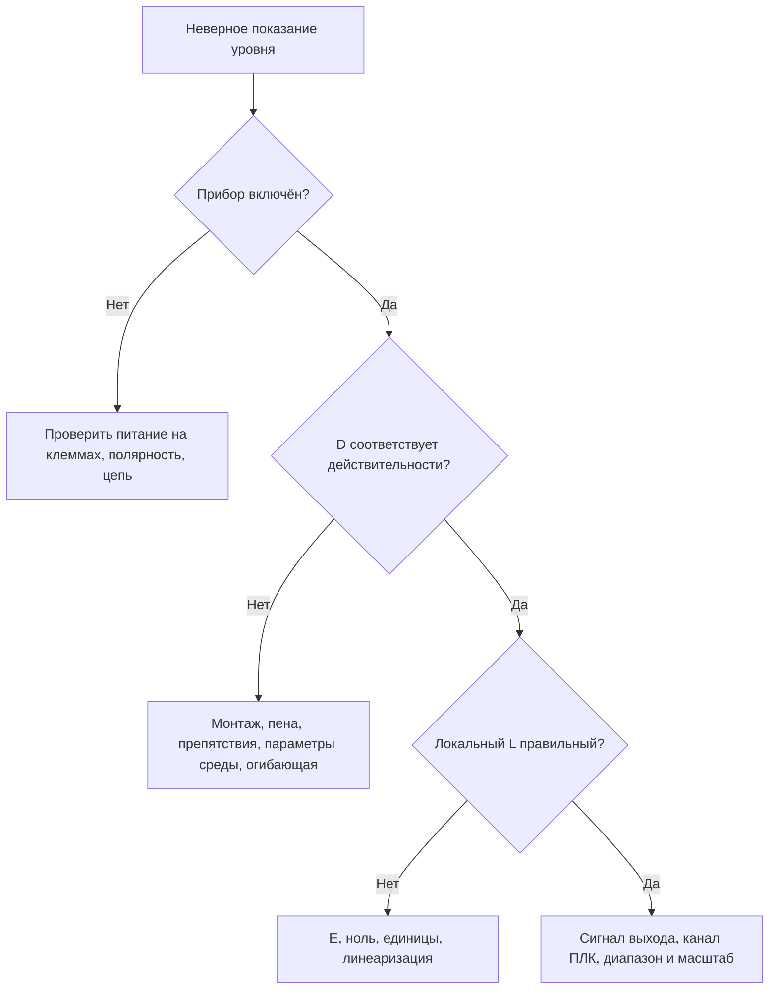

[К оглавлению](README.md) · [Техкарта флотации](00-техкарта-флотация.md)

# 05 · Диагностика по симптомам

Начни с трёх записей: **полный код ошибки, D на приборе, L на приборе**. Затем сравни их с независимой проверкой и показанием ПЛК. Сброс настроек до этого уничтожает полезную информацию.

## Что наблюдаешь и куда смотреть

| Симптом | Проверка по порядку | Основание |
| --- | --- | --- |
| Дисплей не включается | Измерить питание на клеммах, проверить полярность и исполнение; у двухпроводного прибора — целостность петли и падения напряжения | T1, §4; M1, §4; S1, §6 |
| D меньше реального | Возможен захват более близкого отражения: струя, конструкция, пена. Проверить огибающую, монтаж и допустимость карты помех | T1, с.32; M1, с.46; S1, с.55 |
| D больше реального | Проверить среду, процесс, форму бака и E; карта помех не считается исправлением этого случая | T1, с.32; M1, с.46; S1, с.55 |
| D верное, L неверное | Проверить E и нулевую отметку; затем единицы, F и линеаризацию | T1, с.33,38; M1, с.47,53; S1, с.78 |
| L на приборе правильное, на ПЛК нет | Измерить фактический ток, сверить вход и масштаб; проверить назначение выхода, режим simulation/fixed current/multidrop, если он предусмотрен | M1, §4.3; T2/M2, группа output; инженерная проверка цепи |
| Уровень «завис» при реальном изменении | Проверить ложное эхо, загрязнение, место установки; не забыть о симуляции и удержании выхода при потере эха | T1, с.38; M1, §7.2; S1, с.78 |
| Скачки при перемешивании или заполнении | Оценить огибающую, помехи и параметры процесса, затем демпфирование; проверить скорость реакции | T1, с.29–30,38; M1, §6.3.1, §7.2; S1, с.78 |

## Типовые сообщения FMU30 и Prosonic M

| Код | Значение | Что делать первым |
| --- | --- | --- |
| **E641** | Нет пригодного эха | Проверить базовую настройку, поверхность, монтаж и огибающую |
| **E651** | Уровень вошёл в зону SD; риск переполнения | Проверить фактический уровень и расстояние до датчика. Квитирование — после устранения причины, если требуется принятой настройкой |
| **W621** | Включена симуляция | Проверить, кем и зачем включена; завершить согласованную проверку и выключить |
| **W681** | Ток вне рабочего диапазона | Проверить базовую калибровку и линеаризацию |
| **A661** | Перегрев датчика | Сопоставить температуру и допустимые условия исполнения |

Источник: [T1, с.36–37; M1, с.51–52]. Буква E у этих приборов обозначает конфигурируемую реакцию alarm/warning; перед выводом о поведении выхода проверь фактическую настройку.

## Типовые сообщения FMU90 HART

У FMU90 код содержит канал. **Записывай полный текст и полный код**, а не только последние три цифры.

| Код в S1 | Значение | Первое действие |
| --- | --- | --- |
| `E 0x 641` | Нет пригодного эха датчика 01/02 | Проверить базовую настройку и эхо нужного канала |
| `A 0x 651` | Уровень в зоне SD; риск переполнения | Проверить реальный уровень; самоподхват сбрасывать после устранения причины |
| `W 0x 501` | Не выбран датчик для входа | Проверить назначение входа каналу |
| `A 0x 502` | Датчик не распознан | Проверить подключение и выбор типа; действовать по руководству |
| `W 0x 682` | Ток вне диапазона | Проверить настройку и линеаризацию |

Источник: [S1, с.83]. Символ `x` здесь — обозначение переменной части кода из документа, а не буквальный символ на дисплее.

## Что означает аварийный ток

Ток около 22 мА, низкий ток или удержанное последнее значение могут быть заданной реакцией на неисправность. Они не всегда означают обрыв или переполненную ёмкость. Значение берут из действующей настройки `output on alarm`, а не из универсального предположения.

Варианты Hold и пользовательский ток тоже предусмотрены. Значение нижнего аварийного тока проверяй по фактической конфигурации и комплекту документов своего прибора. В выбранных документах FMU30 обнаружено расхождение для MIN; оно отдельно отмечено в [реестре источников](источники.md). Для Prosonic M в M1, с.51, приведено 3,8 мА.

## Чего не делать первым действием

Не выполняй заводской сброс, не удаляй карту и не отключай предупреждение о ближней зоне до фиксации параметров и проверки реального уровня. Не ставь на ПЛК поправку, чтобы скрыть неправильное E или ложное эхо. Сначала определи, на каком участке возникло расхождение.

Для передачи смене используй [шаблон диагностики](../../../../Шаблоны/Диагностика.md).
